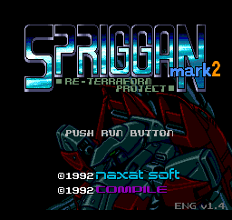
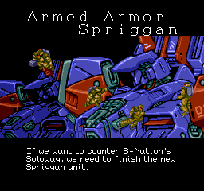
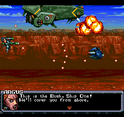
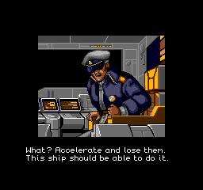
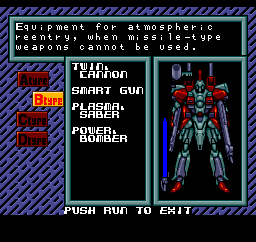
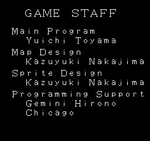

# Spriggan Mark 2 English Version

English version patch for **Spriggan Mark 2: Re-Terraform Project** on PC Engine Super CD-ROM².

This version provides the following:
- English subtitles for voiced cutscenes
- Translated title cards and character labels
- Translated in-level dialogue
- Translated menus, ending sequence, and credits
- Auto-save QoL feature: Continue from last finished level

English text that was already present in the game hasn't been modified except for obvious errors.

Note on audio sync: Subtitle and in-level text timing was calibrated for original PC Engine hardware. Audio synchronization can vary substantially under emulation. If the audio and text drift out of sync, especially during in-level dialogs, try another emulator.

<table align="center">
  <tr>
    <td>
      <a href="https://github.com/gagnonpl/spriggan-mark2-en/raw/master/screenshots/title.png">
        
      </a>
    </td>
    <td>
      <a href="https://github.com/gagnonpl/spriggan-mark2-en/raw/master/screenshots/cutscenes.png">
        
      </a>
    </td>
  </tr>
  <tr>
    <td>
      <a href="https://github.com/gagnonpl/spriggan-mark2-en/raw/master/screenshots/level.png">
        
      </a>
    </td>
    <td>
      <a href="https://github.com/gagnonpl/spriggan-mark2-en/raw/master/screenshots/cutscenes-3.png">
        
      </a>
    </td>
  </tr>
  <tr>
    <td>
      <a href="https://github.com/gagnonpl/spriggan-mark2-en/raw/master/screenshots/weapons.png">
        
      </a>
    </td>
    <td>
      <a href="https://github.com/gagnonpl/spriggan-mark2-en/raw/master/screenshots/credits.png">
        
      </a>
    </td>
  </tr>
</table>

## Downloads

| File | Description |
| --- | --- |
| [`spriggan-mark2-english-track02-v1.4.xdelta`](https://github.com/gagnonpl/spriggan-mark2-en/releases/download/v1.4/spriggan-mark2-english-track02-v1.4.xdelta) | xdelta patch for track 02 |
| [`spriggan-mark2-english-track37-v1.4.xdelta`](https://github.com/gagnonpl/spriggan-mark2-en/releases/download/v1.4/spriggan-mark2-english-track37-v1.4.xdelta) | xdelta patch for track 37 |
| [`README.txt`](https://raw.githubusercontent.com/gagnonpl/spriggan-mark2-en/v1.4/README.txt) | Instructions and hashes |
| [`xdelta`](https://github.com/jmacd/xdelta/releases) | Patching tool |
## Patching

Tracks 02 and 37 are the data tracks and are patched separately with xdelta3.
1. Copy the original Track 02 and Track 37 BIN files to the directory where you want the patched files.
2. Apply each patch separately:
```sh
xdelta3 -f -d \
  -s "Spriggan Mark 2 - Re Terraform Project (Japan) (Track 02).bin" \
  spriggan-mark2-english-track02-v1.4.xdelta \
  "Spriggan Mark 2 - Re Terraform Project (Japan) (Track 02)-patched.bin"

xdelta3 -f -d \
  -s "Spriggan Mark 2 - Re Terraform Project (Japan) (Track 37).bin" \
  spriggan-mark2-english-track37-v1.4.xdelta \
  "Spriggan Mark 2 - Re Terraform Project (Japan) (Track 37)-patched.bin"
```
3. Replace the original Track 02 and Track 37 files with the patched files, renaming the patched files to their original filenames.
4. Keep the original .cue file and all other track files unchanged.

Note that track 37 contains a copy of the data in track 02, used as a redundant copy in case it cannot be read correctly by the PCE.  Patching it should only matter if you play with a disc on original hardware.

## Hashes

### Expected original files

**Redump set:** `NEC - PC Engine CD & TurboGrafx CD`  
**Redump name:** `Spriggan Mark 2 - Re Terraform Project (Japan)`

#### `Spriggan Mark 2 - Re Terraform Project (Japan) (Track 02).bin`
| Hash | Value |
| --- | --- |
| CRC32 | EB604489
| MD5 | 8679be50ee1c2d12e3d6cd5a0a3d1707
| SHA-1 | 6db64581490afbd5f7c538f31bc63a6f0695dcb7

#### `Spriggan Mark 2 - Re Terraform Project (Japan) (Track 37).bin`
| Hash | Value |
| --- | --- |
| CRC32 | D66E0920
| MD5 | fc8d1356ea9f828c5a466f29524e6493
| SHA-1 | eb9b3d55b0acb7e477fd2b262096863c31aacf4d

### Patched output images
#### `Spriggan Mark 2 - Re Terraform Project (Japan) (Track 02).bin`
| Hash | Value |
| --- | --- |
| CRC32 | 03D36967
| MD5 | 7f49832e84ec6f533d3af7a83b0ac04f
| SHA-1 | 4a023dd660d10498283d33701c1bd624de24d46a
#### `Spriggan Mark 2 - Re Terraform Project (Japan) (Track 37).bin`
| Hash | Value |
| --- | --- |
| CRC32 | C9F7B6F0
| MD5 | c9c58b4dace8063efc8cabc611be3e23
| SHA-1 | cba9c31cc6638853bcf1726723d616385274b947

### ROMhacking.net
https://www.romhacking.net/translations/7662/

## Credits

English version by **Luke Gagnon**.
